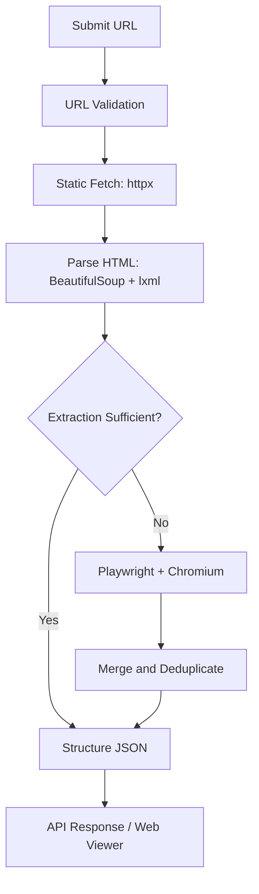

# Universal Web Scraper

A Python-based web scraping application that extracts structured data from static and JavaScript-rendered websites using **FastAPI, BeautifulSoup, httpx, and Playwright**.

The project follows a **static-first scraping strategy**, using browser automation when static extraction is insufficient. Extracted content is organized into structured JSON that can be inspected through a web interface or consumed through a REST API.

[](https://www.python.org/)
[](https://fastapi.tiangolo.com/)
[](https://playwright.dev/python/)
[](LICENSE)

**Tech Stack:** Python · FastAPI · Uvicorn · httpx · BeautifulSoup4 · lxml · Playwright · Chromium · Pydantic · Jinja2 · HTML · CSS · Vanilla JavaScript · unittest · GitHub Actions

## ✨ Key Features

- **Static-First Extraction:** Fetches and parses HTML using `httpx`, BeautifulSoup, and `lxml` before considering browser rendering.
- **JavaScript Rendering:** Uses Playwright and Chromium to extract content from pages that require JavaScript execution.
- **Structured Data Extraction:** Collects page metadata, headings, content sections, links, images, lists, tables, media resources, and supported page components.
- **Browser Interactions:** Attempts supported tab clicks, load-more actions, pagination, and infinite scrolling within configured limits.
- **Data Merging & Deduplication:** Combines static and browser-derived results while filtering duplicate sections and resources.
- **REST API:** Exposes scraping and health-check endpoints through FastAPI.
- **Diagnostics:** Reports extraction strategy, timing statistics, interaction activity, errors, and partial-result information.
- **URL Security:** Validates URLs and restricts disallowed local or private network destinations.
- **JSON Viewer:** Provides a browser interface to submit URLs, inspect extracted results, and download JSON.
- **Automated Testing:** Includes Python regression tests and a GitHub Actions workflow.

## ⚙️ How It Works



1. Validate and normalize the submitted URL.
2. Fetch and parse the page using the static extraction pipeline.
3. Evaluate extraction quality and use Playwright when necessary.
4. Merge and deduplicate extracted content.
5. Return structured JSON with results and diagnostics.

## 🛠️ Getting Started

### Prerequisites

- Python 3.10+
- Git
- Internet connection

### 1. Clone the Repository

```bash
git clone https://github.com/SURAJMUDRAKOLA/Universal-Web-Scraper.git
cd Universal-Web-Scraper
```

### 2. Create a Virtual Environment

**Windows PowerShell**

```powershell
python -m venv venv
venv\Scripts\Activate.ps1
```

**Linux / macOS**

```bash
python3 -m venv .venv
source .venv/bin/activate
```

### 3. Install Dependencies

```bash
python -m pip install --upgrade pip
pip install -r requirements.txt
playwright install chromium
```

### 4. Start the Server

```bash
uvicorn app.main:app --reload --host 127.0.0.1 --port 8000
```

Open the application at **http://127.0.0.1:8000**.

Interactive API documentation is available at **http://127.0.0.1:8000/docs**.

## 🔌 API Endpoints

| Method | Endpoint | Description |
|---|---|---|
| `GET` | `/healthz` | Checks application health |
| `POST` | `/scrape` | Scrapes a URL and returns structured JSON |

**Example request**

```bash
curl -X POST "http://127.0.0.1:8000/scrape" \
  -H "Content-Type: application/json" \
  -d '{"url":"https://example.com"}'
```

The scraping endpoint accepts a JSON body containing a URL. Successful responses include a top-level `result` object with extracted data, statistics, interaction details, and diagnostics. Exact fields and populated resources depend on the target website.

## 🧪 Testing

Run the regression test suite from the project root:

```bash
python -m unittest discover -s tests -p "test_*.py" -v
```

The repository also includes a GitHub Actions workflow for automated testing.

## 📁 Project Structure

```text
Universal-Web-Scraper/
├── app/
│   ├── main.py
│   ├── scraper/
│   │   ├── static.py
│   │   ├── js.py
│   │   └── urls.py
│   └── frontend/
│       └── templates/
│           └── index.html
├── tests/
├── .github/workflows/
├── requirements.txt
├── run.sh
└── README.md
```

## ⚠️ Limitations

- Bot-protected websites and access restrictions may prevent extraction.
- Complex JavaScript applications may return partial results.
- Pagination and infinite-scroll detection are heuristic-based.
- Browser rendering may time out on slow websites.
- Retry policies and rate limiting are not currently implemented.

The scraper does not bypass authentication, CAPTCHAs, or access controls. Always follow applicable laws and target websites' usage policies.

## 🚀 Future Improvements

- Refine the responsive frontend and dark/light theme.
- Expand extraction and security regression tests.
- Improve browser interaction detection.
- Add configurable retries, rate limiting, and operational monitoring.

## 👨‍💻 Author

**Suraj Mudrakola**

**LINKEDIN:** [SURAJMUDRAKOLA](https://www.linkedin.com/in/surajmudrakola)
